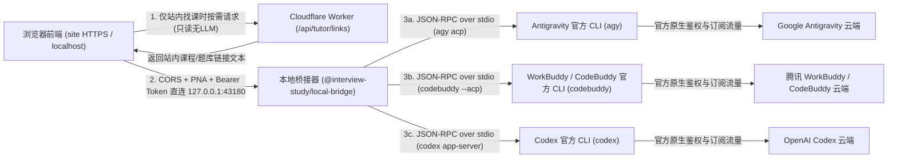

# 本地客户端模型桥接（方式 B：BYO Local Agent）Vibe Coding 开发规范

本文档面向「面试自习室（`site/`）」项目的后续扩展：在不破坏线上 **Next.js + Vinext + Cloudflare Workers + D1** 架构的前提下，通过「线上网页 + 本地轻量桥接器（`local-agent-bridge`）」模式，让用户在浏览器端安全直连自己电脑上已安装并登录的三大官方客户端订阅模型：

- **Google Antigravity**（官方 `agy acp`）
- **OpenAI Codex**（官方 `codex app-server`）
- **腾讯 WorkBuddy / CodeBuddy**（官方 `codebuddy --acp`）

> 本文档按「可直接分段投喂给 AI Coding Agent（Antigravity / Codex / WorkBuddy）执行并验收」的 Vibe Coding 规范编写。执行任何阶段前，请先让 Agent 阅读第 1 章的全局铁律与对应章节的精确契约。

---

## 第 1 章：目标与全局架构（方式 B：BYO Local Agent）

### 1.1 核心定位

Cloudflare Workers 运行在无服务器边缘沙箱中，无法调用操作系统的 `spawn` 拉起本地 CLI 二进制，同时将个人客户端 OAuth 订阅共享到公网后端也违反厂商服务条款。因此采用 **BYO Local Agent（浏览器直连本机 `127.0.0.1` 桥接器）** 方案：

1. **云端零侵入、零额度损耗**：本地客户端的推理请求不经过 Cloudflare Worker 服务器，由用户浏览器直接请求 `http://127.0.0.1:43180`，不消耗站内 DeepSeek / Gemini 每日次数，也不保存任何客户端凭证到云端 D1。
2. **协议解耦与复用**：
   - **Antigravity (`agy acp`)** 与 **WorkBuddy (`codebuddy --acp`)** 同属 **ACP（Agent Client Protocol）** 生态，共用同一套 `AcpStdioDriver` 状态机；
   - **Codex (`codex app-server`)** 使用 OpenAI 官方 JSON-RPC 2.0 `app-server` 协议，由 `CodexAppServerDriver` 独立驱动；
   - 本地桥接器对外统一暴露一套与站内现有 NDJSON（`TutorEvent` / `GradeEvent`）对齐的 `POST /v1/stream` 流式接口。
3. **同构 Prompt 复用**：将 `site/lib/gemini.ts` 中纯文本的提示词构建、JSON 评分清洗、代码框架防作弊过滤抽离至无运行时依赖的 `site/lib/ai-prompts.ts`，确保本地客户端输出与站内评分/批注/教学逻辑 100% 一致；全站 AI 老师需要的站内检索链接则由新增的轻量只读接口 `GET /POST /api/tutor/links` 提供（仅查 D1/目录，不触发 LLM）。

### 1.2 全局架构与数据流图



### 1.3 三大铁律（Global System Rules for Vibe Coding）

> 在后续每个 Vibe Coding 阶段中，以下三条规则为最高约束，任何实现都不得违背：

1. **合规红线（严禁 Token 窃取与协议伪造）**
   - 严禁读取、解密、解析任何客户端本地配置文件中的 OAuth Token、Refresh Token、Cookie 或内部私有 API Key；
   - 严禁在代码中伪造官方客户端的 `User-Agent`、Client Header 或直接构造请求打向厂商非公开 HTTP 接口；
   - 只允许原样拉起用户本机已安装的未修改官方 CLI 子进程（`agy`、`codex`、`codebuddy`），且仅限本机用户单人交互式点击触发（严禁用于 `auto-questions` 等后台无人值守批量出题脚本）。
2. **零副作用只读沙箱（Sandbox Isolation）**
   - 所有驱动启动会话时，工作目录 `cwd` **必须**指向系统临时目录下的固定空目录（例如 `path.join(os.tmpdir(), 'interview-study-empty-sandbox')`，启动时确保其存在且为空目录），严禁把用户真实项目目录或 `HOME` 目录传给 `cwd`；
   - **ACP 驱动（Antigravity / WorkBuddy）**：`initialize` 时必须传 `capabilities: {}`（不向 Agent 暴露 `fs.readTextFile`、`fs.writeTextFile`、`terminal/*` 等客户端能力）；若服务端仍下发 `session/request_permission` 请求，**一律自动返回拒绝/取消结果**，不得执行或放行任何本地读写/Shell 操作；
   - **Codex 驱动**：`thread/start` 必须硬编码传递 `sandbox: "read-only"`、`approvalPolicy: "never"`、`ephemeral: true`。
3. **前端极简规范（`clean-ui-no-extra-copy`，见 `site/AGENTS.md`）**
   - 未经用户明确要求，所有新增或修改的前端 UI **严禁**添加副标题、功能简介、卡片描述、提示横幅、新手引导、使用说明、`ⓘ` 说明气泡、helper text、长 placeholder 或营销文案；
   - 只保留：标题 / 表单 label / 导航、动词型按钮、简短格式示例 placeholder（如 `43180`、`brg_...`）、校验错误、不可逆操作确认、极简空状态与 `aria-label`；
   - 每次修改前端文件输出前，必须对每一句静态文本做**删除测试**（“删掉后用户仍能理解并完成操作就删”）。

---

## 第 2 章：仓库目录规划与精确改动文件清单（File Map）

### 2.1 新增独立本地桥接包（`local-agent-bridge/`）

位于仓库根目录 `local-agent-bridge/`（与 `site/`、`go-server/` 同级），采用纯 Node.js（`>= 22.13.0`，ESM TypeScript/JavaScript）构建，零重型 Web 框架依赖：

| 文件路径 | 职责说明 |
| --- | --- |
| `local-agent-bridge/package.json` | 包定义（`type: "module"`，`bin: { "interview-bridge": "./bin/cli.mjs" }`），可零第三方 HTTP 框架运行，仅按需使用 `@agentclientprotocol/sdk` 或内置轻量 NDJSON-RPC 封装 |
| `local-agent-bridge/tsconfig.json` | TypeScript 编译配置（输出 `dist/` 或 Node 22+ 原生 strip-types / `tsc` 构建） |
| `local-agent-bridge/bin/cli.mjs` | CLI 入口：解析 `--port`（默认 `43180`）、`--allow-origin`、`--reset-token`、`--print-token`，打印本机监听地址、配对码与启动命令 |
| `local-agent-bridge/src/config.ts` | 读写 `~/.interview-study-bridge/config.json`（文件权限 `0o600`），生成 32 字节随机配对码 `brg_<64位hex>`，维护默认允许的 `Origin` 白名单 |
| `local-agent-bridge/src/sandbox.ts` | 创建并返回空沙箱目录 `os.tmpdir()/interview-study-empty-sandbox`，实现跨平台安全可执行文件探测（见第 7 章 Windows `.cmd` 避坑） |
| `local-agent-bridge/src/server.ts` | 基于 `node:http` 仅监听 `127.0.0.1`：实现 Host 校验、Origin 白名单、Chrome PNA 预检头、Bearer Token `timingSafeEqual` 鉴权及 `/v1/*` 路由分发 |
| `local-agent-bridge/src/process-pool.ts` | 子进程生命周期池：懒启动、按 Provider 复用常驻子进程、15 分钟无活动自动回收、单请求并发串行锁、崩溃后自动重建与 `SIGINT`/`SIGTERM` 清理 |
| `local-agent-bridge/src/jsonrpc-stdio.ts` | 基于 `readline` / 行缓冲的 `JSON-RPC 2.0 over stdio` 传输器：过滤非 `{` 开头的噪声行、按 `id` 关联请求/响应、向注册监听器分发服务端请求与通知 |
| `local-agent-bridge/src/drivers/types.ts` | 统一驱动抽象 `LocalAgentDriver`（`detect()`、`listModels()`、`streamTurn()`、`abortTurn()`、`dispose()`）及标准化事件类型 |
| `local-agent-bridge/src/drivers/acp-driver.ts` | 通用 ACP 驱动：通过配置参数区分 `antigravity`（`agy acp`）与 `workbuddy`（`codebuddy --acp`），复用同一状态机 |
| `local-agent-bridge/src/drivers/codex-driver.ts` | Codex 原生驱动：启动并驱动 `codex app-server`，完成握手、模型枚举、只读临时线程、推理/正文流式映射及中断 |

### 2.2 站内同构抽离与前端接入（`site/`）

| 操作 | 文件路径 | 职责说明 |
| --- | --- | --- |
| 新增 | `site/lib/ai-prompts.ts` | 从 `site/lib/gemini.ts` 无损抽离纯 TypeScript 提示词与清洗函数（**严禁导入 `cloudflare:workers`**，保证服务端 Worker 与浏览器端双重兼容） |
| 修改 | `site/lib/gemini.ts` | 改为从 `./ai-prompts` 导入 `GRADE_SYSTEM_PROMPT`、`buildGradeUserPrompt`、`STANDARD_SYSTEM_PROMPT`、`buildStandardUserPrompt`、`parseAndNormalizeGradeResults`、`buildTutorPrompts`、`shouldSearchTutorLinks`、`stripOuterFence` 等，线上行为零变更 |
| 新增 | `site/app/api/tutor/links/route.ts` | 轻量只读站内搜索接口：复用 `sessionUser` + `assertSameOrigin` + `studyCatalog()` + `searchForTutor()`，供本地桥接模式全站找课时获取真实站内链接（不扣额度、不调云端模型） |
| 新增 | `site/lib/local-bridge-config.ts` | 浏览器端 `localStorage` 存储（键名 `local-agent-bridge-v1`）与 `useSyncExternalStore` 订阅 hook；**绝不上传至服务端 D1** |
| 新增 | `site/lib/local-bridge-client.ts` | 浏览器直连 `http://127.0.0.1:<port>` 的客户端封装：健康探活、拉取三大客户端状态与动态模型、流式 AI 问答 `streamTutorViaBridge`、流式评分 `streamGradeViaBridge`、流式规范回答 `streamStandardViaBridge` |
| 修改 | `site/lib/tutor-types.ts` | 扩展 `tutorModelBadge` 支持识别 `local:antigravity/<model>`、`local:codex/<model>`、`local:workbuddy/<model>` 徽章显示 |
| 修改 | `site/lib/grade-types.ts` | 扩展 `gradeModelBadge` 支持识别 `local:` 前缀本地客户端模型徽章显示 |
| 修改 | `site/app/ai/ai-settings.tsx` | 在 `AiSettingsPanel` 中新增极简「本地客户端」配置区（放开给所有端使用，包括未登录访客也可在本机启用，严格遵守 `clean-ui-no-extra-copy`） |
| 修改 | `site/app/ai/ai-dock.tsx` | 在 `ask()` 与模型选择器中增加本地桥接路由分支：当本地桥接开启且 `allowTutor` 为真、且当前模型选择未显式指定站内云端模型时走本地桥接；支持实时思考/打字流与 `AbortController` 中断 |
| 修改 | `site/app/ai/grade-client.ts` | 在 `runGradeNdjson`（含 `requestGrade` 与 `requestStandardAnswer`）中增加本地桥接路由分支：实时流接管 `partialResults` 划词批注预览，结束后浏览器端运行 `parseAndNormalizeGradeResults` 归一化分数 |
| 修改 | `site/app/components/note-ai-client.ts` | 在 `streamNoteAi` 中当本地桥接开启且 `allowTutor` 为真、且笔记本未强制指定站内云端模型时路由至 `streamTutorViaBridge` |

> **关键设计约束**：`site/lib/ai-prompts.ts` 在抽离时，`buildGradeUserPrompt` 与 `parseAndNormalizeGradeResults` 会调用 `@/content/code-starters` 的 `analyzeStarterAnswer` / `filterStarterMarks`（`site/lib/starter-diff.ts`）和 `@/lib/grade-types` 的 `pointScores`。需确保 `site/lib/ai-prompts.ts` 不引入仅服务端可用的大体积题库数据（如 `@/db/*`、`@/lib/site-search` 或 `@/content/*-journey`），避免把整站课程包打进浏览器 Bundle！

---

## 第 3 章：三大客户端底层驱动协议详规（核心技术细节）

桥接器内部定义统一驱动接口（`local-agent-bridge/src/drivers/types.ts`）：

```ts
export type LocalProviderId = 'antigravity' | 'codex' | 'workbuddy';

export type ProviderStatus = 'ready' | 'auth_required' | 'missing_binary' | 'error';

export type LocalModelOption = {
  id: string;
  label: string;
  thinkingLevels?: string[];
};

export type ProviderDetection = {
  id: LocalProviderId;
  name: string;
  status: ProviderStatus;
  binaryPath?: string;
  version?: string;
  defaultModel?: string;
  models: LocalModelOption[];
  loginHint?: string; // 仅简短命令提示，如 "agy acp --login"
  errorMessage?: string;
};

export type StreamTurnInput = {
  model?: string;
  system: string;
  messages: { role: 'user' | 'assistant'; content: string; images?: string[] }[];
  thinkingLevel?: string;
  jsonMode?: boolean;
  signal: AbortSignal;
  onModel: (modelBadgeId: string) => void;
  onThink: (delta: string) => void;
  onDelta: (delta: string) => void;
};

export interface LocalAgentDriver {
  readonly id: LocalProviderId;
  detect(forceRefresh?: boolean): Promise<ProviderDetection>;
  streamTurn(input: StreamTurnInput): Promise<void>;
  dispose(): Promise<void>;
}
```

---

### 3.1 Google Antigravity 驱动（基于通用 `AcpStdioDriver`）

1. **可执行文件探测与启动命令**
   - 命令名：`agy`（可通过环境变量 `ANTIGRAVITY_BIN` 覆盖）。
   - 版本探测：安全执行 `agy --version`（5s 超时）。
   - 启动长连接子进程：`agy acp`（`stdio: ['pipe', 'pipe', 'pipe']`，`cwd: emptySandboxDir`）。
2. **ACP 初始化握手与模型动态枚举**
   - 发送 JSON-RPC Request `initialize`：
     ```json
     {
       "jsonrpc": "2.0",
       "id": 1,
       "method": "initialize",
       "params": {
         "protocolVersion": 1,
         "clientInfo": { "name": "interview-study-bridge", "version": "0.1.0" },
         "capabilities": {}
       }
     }
     ```
   - 紧接着发送 Request `session/new`（建一个空沙箱初始会话以探测当前账号订阅下的可用模型）：
     ```json
     {
       "jsonrpc": "2.0",
       "id": 2,
       "method": "session/new",
       "params": {
         "cwd": "<emptySandboxDir>",
         "mcpServers": []
       }
     }
     ```
   - **未登录状态识别**：若 `initialize` 或 `session/new` 返回错误码/报错文本包含 `auth`、`login`、`unauthorized`、`unauthenticated`、`credential` 或进程退出提示未登录，则将 `status` 设为 `'auth_required'`，设置 `loginHint: 'agy acp --login'`。
   - **动态提取模型列表**：兼容两种 ACP 规范结构：
     - 旧版/稳定字段：`result.models.availableModels`（数组项含 `modelId` / `name`）及 `result.models.currentModelId`；
     - 新版 Session Config Options：`result.configOptions` 中 `category === 'model'` 或 `id === 'model'` 的 `options` 数组（含 `value` / `name`）及 `currentValue`。
3. **单轮提问执行流程（每次请求使用干净会话防止历史串扰）**
   - 因 `site` 前端每次提问/评分已携带完整的 `system` + `messages` 上下文（无状态全量上下文设计），每次 `streamTurn` 新建一个临时 `sessionId`（调用 `session/new`），**绝不复用上一个不同题目的对话历史**（但复用已热启动的 `agy acp` 子进程本身，避免冷启动耗时）。
   - 若请求指定了 `input.model` 且与 `session/new` 默认模型不一致：
     - 若模型来自 `configOptions` 模式，调用 `session/set_config_option`（`{ sessionId, configId, value: input.model }`）；
     - 否则调用 `session/set_model`（`{ sessionId, modelId: input.model }`）。
   - 推送实际使用的模型标签：`onModel('local:antigravity/' + (effectiveModel || 'default'))`。
   - **构建提示词与图片 Block**：
     - 在首段系统文本中追加强约束指令（与 `system` 合并）：禁止调用任何文件/终端/网络工具，直接给出文本回答；
     - 将 `messages` 格式化为清晰的对话文本块（区分 `【User】` / `【Assistant】`），若用户消息包含 `data:image/(png|jpeg|webp|gif);base64,<b64>`，解析出 `mimeType` 与纯 `data`（去掉 `data:...;base64,` 前缀），转为 ACP Content Block：
       ```json
       { "type": "image", "mimeType": "image/png", "data": "<base64>" }
       ```
     - 调用 `session/prompt`：`{ sessionId, prompt: contentBlocks }`。
4. **流式事件与权限拦截**
   - 监听 `session/update` Notification（匹配当前 `params.sessionId`）：
     - `params.update?.sessionUpdate === 'agent_thought_chunk'` 且 `content.type === 'text'` → 调用 `onThink(content.text)`；
     - `params.update?.sessionUpdate === 'agent_message_chunk'` 且 `content.type === 'text'` → 调用 `onDelta(content.text)`；
     - 忽略或记录 `tool_call` / `plan` 等非文本块，不将内部工具报错裸抛为正文。
   - **拦截并拒绝一切越权操作**：若收到 Agent 反向发起的 Request `session/request_permission`（请求执行命令、读写文件），立即回复拒绝响应：
     ```json
     { "jsonrpc": "2.0", "id": "<reqId>", "result": { "outcome": { "outcome": "cancelled" } } }
     ```
   - **中止支持**：监听 `input.signal` 的 `abort` 事件，触发时立即发送 `session/cancel`（`{ sessionId }`）通知并结束当前流。

---

### 3.2 腾讯 WorkBuddy / CodeBuddy 驱动（复用 `AcpStdioDriver`）

WorkBuddy / CodeBuddy Code 官方 CLI 已原生支持 ACP 协议，因此**直接实例化同一个 `AcpStdioDriver`**，仅配置项不同：

1. **可执行文件探测顺序与启动参数**
   - 优先读取环境变量 `WORKBUDDY_BIN` 或 `CODEBUDDY_BIN`；
   - 其次探测系统 `PATH` 中的 `codebuddy`（来自官方包 `npm install -g @tencent-ai/codebuddy-code`）；
   - 启动参数：`['--acp']`（即 `codebuddy --acp`），工作目录同样为 `emptySandboxDir`。
2. **环境变量与登录态兼容性**
   - 继承用户当前本机环境变量（包括可能存在的 `CODEBUDDY_API_KEY`、`CODEBUDDY_INTERNET_ENVIRONMENT` 等用户自行配置的本机环境）；
   - 若未安装二进制，`status: 'missing_binary'`，提示安装命令 `npm i -g @tencent-ai/codebuddy-code`；
   - 若返回鉴权未登录错误，`status: 'auth_required'`，提示 `loginHint: 'codebuddy login'`。
3. **模型发现兜底策略**
   - 若 `session/new` 返回的 `models` / `configOptions` 存在模型列表，直接动态透传给前端；
   - 若某些版本 `codebuddy --acp` 在 `session/new` 响应中未携带可选模型数组，则返回保底列表：`[{ id: 'default', label: 'WorkBuddy 默认模型' }]`，并允许用户在设置页输入框里手动填写账号可用的模型 ID。
4. **流式映射与沙箱安全**
   - 完全复用 `AcpStdioDriver` 的 `agent_thought_chunk` → `think`、`agent_message_chunk` → `delta`、`session/request_permission` 一律拒绝、`session/cancel` 中止逻辑；
   - 模型回传标识：`local:workbuddy/<effectiveModel || 'default'>`。

---

### 3.3 OpenAI Codex 驱动（`CodexAppServerDriver`）

Codex CLI 原生主控制协议为 `codex app-server`（JSON-RPC 2.0 over `stdio`），比社区适配层更稳定且能直接获取完整推理过程与原生模型清单。

1. **可执行文件探测与启动**
   - 命令名：`codex`（可通过环境变量 `CODEX_BIN` 覆盖，来自官方 `@openai/codex`）。
   - 启动参数：`['app-server']`（若版本支持显式参数，默认走 stdio 传输；`cwd: emptySandboxDir`）。
2. **两步握手与模型枚举**
   - Step 1：发送 Request `initialize`：
     ```json
     {
       "jsonrpc": "2.0",
       "id": 1,
       "method": "initialize",
       "params": {
         "clientInfo": {
           "name": "interview-study-bridge",
           "title": "Interview Study Bridge",
           "version": "0.1.0"
         }
       }
     }
     ```
   - Step 2：收到 `initialize` 成功响应后，发送 Notification `initialized`（无 `id`）：
     ```json
     { "jsonrpc": "2.0", "method": "initialized", "params": {} }
     ```
   - Step 3：发送 Request `model/list`（`params: {}`）：
     - 从响应 `result.data`（或 `result.models`）提取 `id` / `model`、`displayName` / `name`、`isDefault`、`supportedReasoningEfforts`；
     - 若检测到未认证错误，标记 `status: 'auth_required'`，`loginHint: 'codex login'`。
3. **单次只读线程推理流**
   - 创建临时只读隔离线程 `thread/start`：
     ```json
     {
       "jsonrpc": "2.0",
       "id": 10,
       "method": "thread/start",
       "params": {
         "model": "<selectedModelOrUndefined>",
         "cwd": "<emptySandboxDir>",
         "sandbox": "read-only",
         "approvalPolicy": "never",
         "ephemeral": true,
         "developerInstructions": "<systemPrompt>"
       }
     }
     ```
     *(注意：若部分版本 `thread/start` 对不传 `model` 较敏感，则使用 `model/list` 返回的默认模型 ID；若 `developerInstructions` 不被旧版字段识别，则回退拼接到首条 `turn/start` 文本前。)*
   - 推送实际模型标识：`onModel('local:codex/' + (resolvedModel || 'default'))`。
   - 将历史对话与当前用户消息映射为 `turn/start` 的 `input` 列表：
     - 纯对话历史与最新消息合并为结构化上下文输入 items：`{ type: "text", text: "..." }`；
     - 含图片时，直接以 Data URL 形式追加 `{ type: "image", url: dataUrl }`；
     - 思考强度映射：`thinkingLevel`（`low` / `medium` / `high` / `xhigh` / `max`）映射为 `effort`（`xhigh`/`max` → `'high'`，`off` → `'low'`，其他透传）；
     - 发送 Request `turn/start`：`{ threadId, input, effort }`，记录返回的 `turn.id`。
4. **流式通知事件映射与中断**
   - 监听通知（按 `params.threadId` / `params.turnId` 匹配当前 Turn）：
     - `item/reasoning/summaryTextDelta` 或 `item/reasoning/textDelta` → `onThink(params.delta)`
     - `item/agentMessage/delta` → `onDelta(params.delta)`
     - `turn/completed` → 若 `params.turn?.status === 'failed'` 则抛出错误 `params.turn?.error?.message`；若正常完成则结束 `streamTurn`；
     - `error` → 抛出上游错误。
   - **严防任何工具/审批挂起**：因为设定了 `approvalPolicy: "never"` + `sandbox: "read-only"`，正常不会触发工具；若仍收到任何审批类 Server Request，一律回复 `{ decision: "decline" }` 或 `{ approved: false }`。
   - **中止支持**：`input.signal` 触发 `abort` 时，立即发送 Request `turn/interrupt`：`{ threadId, turnId }`。

---

## 第 4 章：本地桥接服务 HTTP 接口与浏览器跨域安全规范

### 4.1 强制安全中间件（缺一不可）

`local-agent-bridge/src/server.ts` 必须严格按以下顺序校验每个入站 HTTP 请求：

1. **回环地址绑定**：`server.listen(port, '127.0.0.1')`，**绝对禁止**监听 `0.0.0.0` 或 `::`。
2. **Host 头防御（防 DNS Rebinding）**：
   - `req.headers.host` 必须严格等于 `127.0.0.1:${port}` 或 `localhost:${port}`（不区分大小写）；否则直接返回 `403 Forbidden`。
3. **Origin 白名单 + PNA 预检头（防任意第三方网页盗用本机额度）**：
   - 静态内置允许列表 + CLI `--allow-origin` 扩展：
     - `http://localhost:3000`、`http://127.0.0.1:3000`、`http://localhost:8787`、`http://127.0.0.1:8787`
     - `https://exhan.dpdns.org` 及任意子域 `^https://[a-z0-9-]+\.exhan\.dpdns\.org$`
   - 若请求携带了 `Origin` 头但**不在白名单内**，一律返回 `403 { error: "forbidden_origin", message: "未授权的来源域名" }`。
   - **绝不输出 `Access-Control-Allow-Origin: *`**；仅当 `Origin` 匹配白名单时，才在响应头写入：
     - `Access-Control-Allow-Origin: <origin>`
     - `Vary: Origin`
     - `Access-Control-Allow-Methods: GET, POST, OPTIONS`
     - `Access-Control-Allow-Headers: Content-Type, Authorization`
     - 若请求包含 `Access-Control-Request-Private-Network: true`（Chrome PNA 预检），额外写入：`Access-Control-Allow-Private-Network: true`；遇到 `OPTIONS` 预检直接返回 `204 No Content`。
4. **Bearer 配对码鉴权**：
   - 启动时 `config.ts` 检查 `~/.interview-study-bridge/config.json`，不存在则生成 `brg_` + `crypto.randomBytes(32).toString('hex')` 并以 `0o600` 权限落盘；
   - 除 `OPTIONS` 与公开心跳 `GET /v1/ping` 外，所有接口必须校验 `Authorization: Bearer <token>`，使用 `crypto.timingSafeEqual` 比对定长 Buffer；校验失败返回 `401 { error: "unauthorized", message: "配对码无效" }`。

### 4.2 四个核心 HTTP 端点契约

#### 1) `GET /v1/ping`（公开，无鉴权，严禁泄露任何环境或账号信息）
- **响应 `200 OK`**：
  ```json
  { "ok": true, "name": "interview-study-bridge", "version": "0.1.0" }
  ```

#### 2) `GET /v1/providers`（需 Bearer 鉴权）
- **作用**：并发检测本机 `antigravity`、`codex`、`workbuddy` 安装与登录状态，返回各客户端动态模型列表。
- **响应 `200 OK`**：
  ```json
  {
    "providers": [
      {
        "id": "antigravity",
        "name": "Google Antigravity",
        "status": "ready",
        "binaryPath": "C:\\...\\agy.exe",
        "version": "1.2.0",
        "defaultModel": "gemini-4-hydrogen",
        "models": [
          { "id": "gemini-4-hydrogen", "label": "Gemini 4 Hydrogen" },
          { "id": "gemini-3.8-flash", "label": "Gemini 3.8 Flash" }
        ]
      },
      {
        "id": "codex",
        "name": "OpenAI Codex",
        "status": "auth_required",
        "binaryPath": "C:\\...\\codex.cmd",
        "models": [],
        "loginHint": "codex login"
      },
      {
        "id": "workbuddy",
        "name": "WorkBuddy / CodeBuddy",
        "status": "missing_binary",
        "models": [],
        "loginHint": "npm i -g @tencent-ai/codebuddy-code"
      }
    ]
  }
  ```

#### 3) `POST /v1/providers/:id/refresh`（需 Bearer 鉴权）
- **作用**：关闭并重建 `:id`（`antigravity` | `codex` | `workbuddy`）的子进程池实例，强制重新探测登录态与模型目录。
- **响应 `200 OK`**：返回更新后的单个 `ProviderDetection` 对象。

#### 4) `POST /v1/stream`（需 Bearer 鉴权）
- **请求体（`application/json`）**：
  ```json
  {
    "provider": "antigravity",
    "model": "gemini-4-hydrogen",
    "system": "你是严格但友善的面试题阅卷老师...",
    "messages": [
      { "role": "user", "content": "...", "images": ["data:image/png;base64,..."] }
    ],
    "thinkingLevel": "auto",
    "jsonMode": true
  }
  ```
- **JSON 模式自动加固**：因本地 Agent 协议没有原生 `responseSchema` 硬件锁，当 `req.jsonMode === true` 时，服务端应在 `system` 末尾追加严格声明：
  `"\n\n[OUTPUT CONSTRAINT] 严禁输出任何工具调用、思考说明或 Markdown 围栏之外的多余解释，必须严格输出单个合法 JSON 对象。"`
- **响应格式（`Content-Type: application/x-ndjson; charset=utf-8`，`Cache-Control: no-store, no-transform`）**：
  每行一个 JSON 对象（事件格式与 `site/lib/tutor-types.ts`、`site/lib/grade-types.ts` 对齐）：
  ```json
  {"t":"start"}
  {"t":"model","model":"local:antigravity/gemini-4-hydrogen"}
  {"t":"think","text":"首先核对得分点..."}
  {"t":"delta","text":"{\"results\":[...]}"}
  {"t":"done","model":"local:antigravity/gemini-4-hydrogen"}
  ```
  失败时输出错误行并关闭流：
  ```json
  {"t":"error","code":"auth_required","message":"请先在终端运行 agy acp --login 登录 Antigravity"}
  ```

---

## 第 5 章：站内前端接入与 `clean-ui-no-extra-copy` 界面规范

### 5.1 浏览器侧状态存储（`site/lib/local-bridge-config.ts`）

使用纯 `localStorage` 存储（**严禁调用 `/api/ai-config` 把配对码写进 D1**），推荐数据结构与默认值：

```ts
export type LocalBridgeProvider = 'antigravity' | 'codex' | 'workbuddy';

export type LocalBridgeConfig = {
  enabled: boolean;
  port: number;            // 默认 43180
  token: string;           // brg_...
  provider: LocalBridgeProvider;
  model: string;           // 空字符串表示由客户端默认模型决定
  allowTutor: boolean;     // 默认 true（AI 问答与笔记润色）
  allowGrade: boolean;     // 默认 true（主观题 AI 评分与规范回答）
};
```

通过 `useSyncExternalStore` 暴露 `useLocalBridgeConfig()`、`getLocalBridgeConfig()`、`saveLocalBridgeConfig()`，并监听浏览器 `storage` 事件实现多标签页同步。

### 5.2 前端调用链路对接

1. **AI 问答面板（`site/app/ai/ai-dock.tsx`）与笔记 AI（`site/app/components/note-ai-client.ts`）**
   - 路由判定规则：当 `localCfg.enabled && localCfg.token && localCfg.allowTutor` 为真，且当前选中的模型为 `'auto'` 或 `'local'`（即用户没有在聊天栏顶部下拉框特意切回某个站内云端模型如 `deepseek-v4-pro` / `gemini-4` 或 `'custom'`）时，直接走 `streamTutorViaBridge(...)`；
   - **模型下拉框适配（`ai-dock.tsx` 的 `modelPicker`）**：当本地桥接启用时，保留原有站内选项并增加 `<option value="local">本地：{providerLabel}</option>`，同时在 `'auto'` 默认模式下显示 `默认（本地 {providerLabel}）`；
   - **站内找课检索保留**：在 `streamTutorViaBridge` 中调用 `shouldSearchTutorLinks(context, messages)`，仅当需要搜站内链接（`context.kind === 'site'` 或命中 `ASKS_WHERE` 正则）时，先发起 `fetch('/api/tutor/links', { method: 'POST', ... })`（超时 2.5s，失败时静默降级 `found = ''`），再拼出完整 `system` + `messages` 发往 `http://127.0.0.1:<port>/v1/stream`；
   - **额度展示**：本地桥接返回 `remaining: undefined`（或不在气泡末尾渲染“今日还剩 N 次”站内扣费提示），失败时直接提示本机错误原因（如“本地桥接未启动”或“配对码无效”）。
2. **主观题 AI 评分与规范回答（`site/app/ai/grade-client.ts`）**
   - 路由判定规则：在 `runGradeNdjson` 中，当 `localCfg.enabled && localCfg.token && localCfg.allowGrade` 为真，且 `gm === 'auto'`（用户未强制选站内 `gemini` / `deepseek` / `custom`）或新增的 `gm === 'local'` 时，走 `streamGradeViaBridge(...)` / `streamStandardViaBridge(...)`；
   - **实时划词批注预览**：`streamGradeViaBridge` 每收到一行 `{"t":"delta"}`，原样累积 `got` 并触发 `onProgress(got)`，因此页面现有的 `partialResults(items, s)` 逐点得分与原文 `marks` 实时划词动画**零改造直接复用**；
   - **流结束后归一化 & JSON 容错重试**：收到 `done` 后，调用 `site/lib/ai-prompts.ts` 导出的 `parseAndNormalizeGradeResults(items, got)`（提取最外层 `{ ... }` JSON 对象、修复常见尾逗号/Markdown 围栏、夹紧 `0..max` 按 `0.5` 取整、执行 `filterStarterMarks` 过滤未作答框架代码）；若首次解析失败，向调用方发送一次 `onReset` 并附带纠错提示自动重试 1 次（仍失败则明确报错，不静默丢分）。

### 5.3 设置界面 UI 强约束（严格遵守 `clean-ui-no-extra-copy`）

修改 `site/app/ai/ai-settings.tsx` 时，**注意 `AiSettingsPanel` 之前在 `isGuest` 分支直接提前 `return` 了**！必须把「本地客户端」配置块提取为独立子组件 `<LocalBridgeSection L={L} />`，同时在**未登录访客视图与已登录视图**中均可渲染（因为本地桥接完全跑在用户自己的电脑上，不消耗站内云端资源）。

`<LocalBridgeSection />` 必须严格通过**删除测试**，以下为**合规正例骨架**：

```tsx
<section className="ai-cfg-local">
  <div className="ai-cfg-head">
    <strong>{L('本地客户端', 'Local Client')}</strong>
    {probeState !== 'idle' && (
      <span className={`ai-cfg-status ${probeState}`}>{probeLabel}</span>
    )}
  </div>

  <label className="ai-cfg-toggle">
    <input
      type="checkbox"
      checked={localCfg.enabled}
      onChange={e => updateLocal({ enabled: e.target.checked })}
    />
    <span>{L('启用本地客户端', 'Enable local client')}</span>
  </label>

  <div className="ai-cfg-field">
    <span className="ai-cfg-label">{L('客户端', 'Client')}</span>
    <div className="ai-cfg-providers">
      {(['antigravity', 'codex', 'workbuddy'] as const).map(id => (
        <button
          key={id}
          type="button"
          className={'ai-cfg-prov' + (localCfg.provider === id ? ' on' : '')}
          onClick={() => pickLocalProvider(id)}
        >
          {LOCAL_PROVIDER_LABEL[id]}
        </button>
      ))}
    </div>
  </div>

  <div className="ai-cfg-grid">
    <label>
      <span className="ai-cfg-label">{L('端口', 'Port')}</span>
      <input
        type="number"
        className="ai-cfg-input"
        value={localCfg.port}
        placeholder="43180"
        onChange={e => updateLocal({ port: Number(e.target.value) || 43180 })}
      />
    </label>
    <label>
      <span className="ai-cfg-label">{L('配对码', 'Pairing Token')}</span>
      <input
        type="password"
        className="ai-cfg-input"
        value={localCfg.token}
        placeholder="brg_..."
        onChange={e => updateLocal({ token: e.target.value })}
      />
    </label>
  </div>

  <div className="ai-cfg-field">
    <div className="ai-cfg-row-head">
      <span className="ai-cfg-label">{L('模型', 'Model')}</span>
      <button
        type="button"
        className="ai-cfg-chip"
        disabled={probing}
        onClick={() => void refreshProviders()}
      >
        {L('刷新', 'Refresh')}
      </button>
    </div>
    {activeProvider?.models.length ? (
      <div className="ai-cfg-models">
        {activeProvider.models.map(m => (
          <button
            key={m.id}
            type="button"
            className={'ai-cfg-chip' + (localCfg.model === m.id ? ' on' : '')}
            onClick={() => updateLocal({ model: m.id })}
          >
            {m.label}
          </button>
        ))}
      </div>
    ) : null}
    <input
      className="ai-cfg-input"
      value={localCfg.model}
      placeholder={activeProvider?.defaultModel || 'default'}
      onChange={e => updateLocal({ model: e.target.value })}
    />
  </div>

  <div className="ai-cfg-scenes">
    <label>
      <input
        type="checkbox"
        checked={localCfg.allowTutor}
        onChange={e => updateLocal({ allowTutor: e.target.checked })}
      />
      <span>{L('AI 问答', 'AI Tutor')}</span>
    </label>
    <label>
      <input
        type="checkbox"
        checked={localCfg.allowGrade}
        onChange={e => updateLocal({ allowGrade: e.target.checked })}
      />
      <span>{L('AI 评分', 'AI Grading')}</span>
    </label>
  </div>

  <div className="ai-cfg-actions">
    <button type="button" className="button primary" onClick={() => void testAndSave()}>
      {L('连接并保存', 'Connect & Save')}
    </button>
    <button type="button" className="button secondary" onClick={() => void copyLaunchCmd()}>
      {copiedCmd ? L('已复制', 'Copied') : L('复制启动命令', 'Copy command')}
    </button>
  </div>
</section>
```

**严禁出现以下反例**：
- ❌ `<p className="muted">通过本地桥接器直连您电脑上的 Antigravity/Codex/WorkBuddy，不经过站点服务器...</p>`
- ❌ `<small>请在终端运行 npx @interview-study/local-bridge 后粘贴配对码，我们绝不上传您的凭证</small>`
- ❌ 按钮旁边的 `ⓘ` 气泡、折叠教程步骤卡片、或者长 placeholder（如 `"请输入终端打印的 64 位 brg_ 开头配对码"`）。

---

## 第 6 章：五阶段 Vibe Coding 投喂手册（Copy-Pasteable Agent Prompts）

> 建议按顺序每完成一个 Phase 并跑通对应验收项后，再向 AI Coding Agent 投喂下一个 Phase 的 Prompt。

---

### Phase 1：站内 Prompt 与评分归一化同构抽离（零行为变更重构）

- **涉及文件**：
  - 新增 `site/lib/ai-prompts.ts`
  - 修改 `site/lib/gemini.ts`
  - 新增 `site/app/api/tutor/links/route.ts`

````markdown
请严格执行 Phase 1：仅抽离纯函数与新增只读搜索接口，不要改动任何 UI、不要修改现有云端模型调用逻辑或行为。

任务 1：新建 `site/lib/ai-prompts.ts`（纯 TypeScript，严禁导入 `cloudflare:workers`、`@/db/*` 或 `@/content/*-journey`）。
请参考 `site/lib/gemini.ts` 中现有实现，无损抽离并导出以下能力：
1. 评分提示词与解析：
   - `GRADE_SYSTEM_PROMPT`（原 `system`）
   - `buildGradeUserPrompt(items: GradeItem[])`（原 `prompt(items)`，保留 `pointScores`、`analyzeStarterAnswer` 逻辑）
   - `parseGradeJsonRaw(text: string)` 与 `parseAndNormalizeGradeResults(items: GradeItem[], text: string): GradeResult[]`（原 `parseJsonRaw` + `normalize`，并增强 JSON 截取：从第一个 `{` 到最后一个 `}` 提取合法 JSON 容错）
   - `STANDARD_SYSTEM_PROMPT`（原 `standardSystem`）与 `buildStandardUserPrompt(item: GradeItem)`（原 `standardPrompt`）
2. AI 老师提示词与搜课判定：
   - `TUTOR_ASKS_WHERE_RE`（原 `site/app/api/tutor/route.ts` 中的 `ASKS_WHERE` 正则）
   - `shouldSearchTutorLinks(context: TutorContext, messages: TutorMessage[]): boolean`（复刻 `findLinks` 中的前置判断）
   - `buildTutorPrompts(context: TutorContext, messages: TutorMessage[], foundLinks?: string): { system: string; messages: { role: 'user' | 'assistant'; content: string; images?: string[] }[] }`（原样复刻 `tutorBase`、`modeRule`、`contextText`、`linkRule`）
3. 操场与通用清理：
   - `stripOuterFence(raw: string): string`、`buildPlaygroundCompletePrompts(...)`

任务 2：更新 `site/lib/gemini.ts`，改为从 `./ai-prompts` 导入上述常量与函数，确保 `gradeStream`、`standardAnswerStream`、`tutorStream`、`completePlaygroundCode` 的输出和行为与重构前完全一致。

任务 3：新建 `site/app/api/tutor/links/route.ts`（`export const dynamic = 'force-dynamic'`）：
- `POST` 处理：校验 `assertSameOrigin(req)` 与 `sessionUser(req.headers)`（未登录返回 401）；
- 使用 `site/app/api/tutor/route.ts` 相同的 `contextOf` 与消息基本校验解析 `{ context, messages }`；
- 调用 `studyCatalog()` 与 `searchForTutor()`（从 `@/db/catalog` 与 `@/lib/site-search` 导入）返回 `Response.json({ links })`；
- 该路由绝不扣除 `ai_tutor_quota` 额度，也不调用任何 LLM API。

验收自检：运行 `pnpm --dir site run lint` 与 `pnpm --dir site run build`，确保无任何 TypeScript、ESLint 或浏览器端打包报错。
````

- **Phase 1 验收标准**：
  - `pnpm --dir site run lint` 通过；
  - `pnpm --dir site run build` 通过；
  - 检查构建产物中浏览器 bundle 未意外打入 `@/db/catalog` 或 `site-search`。

---

### Phase 2：搭建 `local-agent-bridge` 核心 HTTP 服务、安全中间件与进程池框架

- **涉及文件**：
  - `local-agent-bridge/package.json`、`local-agent-bridge/tsconfig.json`
  - `local-agent-bridge/bin/cli.mjs`
  - `local-agent-bridge/src/config.ts`、`sandbox.ts`、`jsonrpc-stdio.ts`、`process-pool.ts`、`server.ts`
  - `local-agent-bridge/src/drivers/types.ts`

````markdown
请严格执行 Phase 2：在仓库根目录创建独立子包 `local-agent-bridge/`，搭建支持 Node.js >= 22 ESM 的本地 HTTP 桥接服务端核心骨架与安全层（先接入 Mock Driver 跑通接口，不伪造官方客户端代码）。

具体要求：
1. 包配置与 CLI 入口（`package.json`、`bin/cli.mjs`）：
   - `type: "module"`，提供可执行入口 `./bin/cli.mjs`（支持 `--port 43180`、`--allow-origin <url>`、`--reset-token`、`--print-token`）。
   - 启动时在终端清晰打印监听地址（`http://127.0.0.1:<port>`）和当前配对码（`brg_...`）。
2. 配对码与配置管理（`src/config.ts`）：
   - 配置文件存放在 `path.join(os.homedir(), '.interview-study-bridge', 'config.json')`，目录权限 `0o700`，文件权限 `0o600`。
   - 首次创建或 `--reset-token` 时使用 `crypto.randomBytes(32).toString('hex')` 生成 `brg_<hex>`。
3. 沙箱与跨平台可执行路径解析（`src/sandbox.ts`）：
   - 维护空沙箱目录 `path.join(os.tmpdir(), 'interview-study-empty-sandbox')`，启动时确保创建且不含敏感文件。
   - 实现 `resolveSafeCommand(binName, args)`：在 Windows 上通过 `where.exe` 解析真实路径；若解析结果为 `.cmd` / `.bat`（npm 全局垫片），优先解析 `.cmd` 同级目录或脚本内引用的 `.js` CLI 入口并用 `process.execPath` 直接拉起，避免 `shell: true` 参数注入风险或直接 `spawn` 报 `ENOENT`。
4. HTTP 服务与强制安全中间件（`src/server.ts`，基于原生 `node:http`）：
   - 仅绑定 `127.0.0.1`（禁止 `0.0.0.0`）；
   - `Host` 白名单校验：仅允许 `127.0.0.1:<port>` 与 `localhost:<port>`，否则返回 403；
   - `Origin` 白名单校验：默认允许 `http://localhost:3000`、`http://127.0.0.1:3000`、`http://localhost:8787`、`http://127.0.0.1:8787`、`https://exhan.dpdns.org` 及 `https://*.exhan.dpdns.org`（加 CLI `--allow-origin`）。存在非白名单 `Origin` 时返回 403；绝不使用 `*`；
   - Chrome PNA 预检：支持 `OPTIONS` 请求且当包含 `Access-Control-Request-Private-Network: true` 时返回 `Access-Control-Allow-Private-Network: true`；
   - Bearer 鉴权：除 `OPTIONS` 和 `GET /v1/ping`（仅返回 `{ ok: true, name: "interview-study-bridge", version: "0.1.0" }`）外，强制用 `crypto.timingSafeEqual` 校验 `Authorization: Bearer <token>`，失败返回 401；
   - 实现路由：`GET /v1/ping`、`GET /v1/providers`、`POST /v1/providers/:id/refresh`、`POST /v1/stream`（输出 NDJSON 事件流：`start` / `model` / `think` / `delta` / `done` / `error`，支持 `req.on('close')` 触发 `AbortController`）。
5. 通用 JSON-RPC 2.0 `stdio` 传输与进程池（`src/jsonrpc-stdio.ts`、`src/process-pool.ts`、`src/drivers/types.ts`）：
   - 按行解析 `stdout`，自动忽略非 `{` 开头的噪声横幅行；`stderr` 保留最近 100 行环形缓冲用于诊断；
   - `process-pool.ts` 管理子进程复用、15 分钟空闲回收、并发串行锁与进程退出清理。

请同时编写节点原生单元测试（`node --test`）验证安全拦截（非法 Host 403、非法 Origin 403、缺 Token 401、PNA OPTIONS 响应头 204）与 Mock NDJSON 流。
````

- **Phase 2 验收标准**：
  - `node --test` 安全测试全绿；
  - `OPTIONS` 带 `Origin: https://exhan.dpdns.org` 与 `Access-Control-Request-Private-Network: true` 返回 `204` 及对应响应头；
  - 无 Bearer Token 请求 `/v1/providers` 返回 `401`；带正确 Token 返回 `200`。

---

### Phase 3：实现 `AcpStdioDriver`（打通 Antigravity `agy acp` 与 WorkBuddy `codebuddy --acp`）

- **涉及文件**：
  - `local-agent-bridge/src/drivers/acp-driver.ts`
  - 修改 `local-agent-bridge/src/process-pool.ts` / `server.ts` 注册 `antigravity` 与 `workbuddy`

````markdown
请严格执行 Phase 3：实现通用 ACP 驱动 `local-agent-bridge/src/drivers/acp-driver.ts`，同时接入 Google Antigravity（`agy acp`）与腾讯 WorkBuddy / CodeBuddy（`codebuddy --acp`）。

严格遵守以下协议与安全细节（参考文档第 1 章与第 3.1/3.2 节）：
1. **双 Provider 实例化**：
   - `antigravity`：探测 `process.env.ANTIGRAVITY_BIN || 'agy'`，参数 `['acp']`，未登录提示 `agy acp --login`。
   - `workbuddy`：按序探测 `process.env.WORKBUDDY_BIN || process.env.CODEBUDDY_BIN || 'codebuddy'`，参数 `['--acp']`，未安装提示 `npm i -g @tencent-ai/codebuddy-code`，未登录提示 `codebuddy login`。
   - 严禁读取客户端本地配置中的 Token 文件，完全依赖官方 CLI 自身原生登录态。
2. **ACP 握手与只读沙箱**：
   - 复用第 2 阶段完成的 `JsonRpcStdioClient` 与 `emptySandboxDir`；
   - 发送 `initialize`：`{ protocolVersion: 1, clientInfo: { name: 'interview-study-bridge', version: '0.1.0' }, capabilities: {} }`；
   - 调用 `session/new`：`{ cwd: emptySandboxDir, mcpServers: [] }`；
   - 模型列表提取同时兼容 `result.models.availableModels` 与 `result.configOptions`（`category === 'model'` 或 `id === 'model'`）。对 WorkBuddy，若返回空列表则兜底返回 `[{ id: 'default', label: 'WorkBuddy 默认模型' }]`。
3. **只读拦截与权限拒绝**：
   - 若子进程下发任何 `session/request_permission` 请求，立即响应 `{ outcome: { outcome: 'cancelled' } }`，绝不批准任何文件读写或终端命令。
4. **单轮推理与模型切换**：
   - 每次 `streamTurn` 在已预热的 ACP 子进程上创建干净的临时 `session/new`（防止不同题目污染上下文）；
   - 如请求指定了 `model` 且不为 `'default'`，尝试调用 `session/set_config_option` 或 `session/set_model` 切换模型（兼容不同服务端支持的方法名）；
   - 如 `jsonMode === true`，在 `system` 末尾追加严格仅输出合法 JSON 的提示约束；
   - 支持将消息中的 `data:image/...;base64,...` 转换为 `{ type: 'image', mimeType, data }` Content Block；
   - 监听 `session/update` 通知：将 `agent_thought_chunk` 转发为 `onThink`，`agent_message_chunk` 转发为 `onDelta`；
   - 监听 `AbortSignal`：触发时立即发送 `session/cancel`（`{ sessionId }`）停止上游生成。

请补充单元测试（使用模拟 stdio JSON-RPC 脚本模拟 ACP 服务端）：验证模型列表解析、`session/request_permission` 自动拒绝、`agent_thought_chunk`/`agent_message_chunk` 流式映射与 `session/cancel` 中断。
````

- **Phase 3 验收标准**：
  - 单元测试（Mock ACP 子进程）通过；
  - 若本机已安装并登录 `agy` 或 `codebuddy`，执行 `GET /v1/providers` 能返回 `status: "ready"` 及对应模型列表，且 `POST /v1/stream` 可流式返回思考与正文。

---

### Phase 4：实现 `CodexAppServerDriver`（打通 OpenAI Codex `codex app-server`）

- **涉及文件**：
  - `local-agent-bridge/src/drivers/codex-driver.ts`
  - 修改 `local-agent-bridge/src/process-pool.ts` / `server.ts` 注册 `codex`

````markdown
请严格执行 Phase 4：实现 OpenAI Codex 驱动 `local-agent-bridge/src/drivers/codex-driver.ts`，通过官方 `codex app-server` JSON-RPC over stdio 接入。

严格遵守以下协议与安全细节（参考文档第 3.3 节）：
1. **探测与握手**：
   - 探测 `process.env.CODEX_BIN || 'codex'`，启动参数 `['app-server']`，`cwd` 必须为 `emptySandboxDir`。
   - 握手顺序：发送 Request `initialize`（`{ clientInfo: { name: 'interview-study-bridge', title: 'Interview Study Bridge', version: '0.1.0' } }`），收到成功响应后再发送 Notification `initialized`（`{}`）。
   - 调用 `model/list`（`{}`）解析账号可用模型列表及默认模型；遇鉴权错误标记 `status: 'auth_required'` 并设置 `loginHint: 'codex login'`。
2. **只读临时线程与单轮执行**：
   - 每次 `streamTurn` 调用 `thread/start`：必须显式传递 `cwd: emptySandboxDir`、`sandbox: 'read-only'`、`approvalPolicy: 'never'`、`ephemeral: true` 与 `developerInstructions: systemWithConstraints`（如旧版不识别 `developerInstructions`，回退将系统提示合并进首条用户文本）；
   - 将历史消息与当前消息转换为 `input` 数组（文本 `{ type: 'text', text }`，Base64 图片 `{ type: 'image', url: dataUrl }`）；将 `thinkingLevel` 映射为 `effort`（`low` / `medium` / `high`）；调用 `turn/start`（`{ threadId, input, effort }`）；
   - 监听 `item/reasoning/summaryTextDelta` / `item/reasoning/textDelta` → `onThink`；监听 `item/agentMessage/delta` → `onDelta`；监听 `turn/completed`（核对 `turn.status`，失败时提取 `turn.error.message` 抛出）；
   - 若收到任何审批类 Server Request，一律回复拒绝；
   - 监听 `AbortSignal`：触发时立即发送 `turn/interrupt`（`{ threadId, turnId }`）。

请补充单元测试（使用模拟 Codex App Server 脚本）：验证 `initialize -> initialized -> model/list` 握手顺序、`thread/start` 参数强制包含 `sandbox: "read-only"` 与 `approvalPolicy: "never"`、`effort` 映射、`turn/interrupt` 取消及失败报错传播。
````

- **Phase 4 验收标准**：
  - Codex 驱动单元测试通过；
  - 若本机已安装并登录 `codex`，`GET /v1/providers` 返回 Codex 可用模型列表，用测试 Prompt 尝试诱导模型读取本机磁盘文件或运行 shell 命令时，能被沙箱安全拦截。

---

### Phase 5：站内前端直连集成与极简设置界面（端到端闭环）

- **涉及文件**：
  - 新增 `site/lib/local-bridge-config.ts`、`site/lib/local-bridge-client.ts`
  - 修改 `site/lib/tutor-types.ts`、`site/lib/grade-types.ts`
  - 修改 `site/app/ai/ai-settings.tsx`、`site/app/ai/ai-dock.tsx`、`site/app/ai/grade-client.ts`、`site/app/components/note-ai-client.ts`

````markdown
请严格执行 Phase 5：在 `site/` 中接入本地客户端桥接模式（方式 B）。

严格规则：
- 必须严格遵守 `site/AGENTS.md` 中的 `clean-ui-no-extra-copy` 规范！禁止向任何 UI 页面添加副标题、功能简介、提示横幅、说明小字、ⓘ 气泡、helper text 或长 placeholder。修改完每个组件后，对每一句静态文案做“删除测试”。
- 严禁把本机配对码上传到 `/api/ai-config` 或任何云端接口；配对码与本地配置只能保存在浏览器 `localStorage`。

具体实现要求：
1. 新建 `site/lib/local-bridge-config.ts`：
   - 以键名 `local-agent-bridge-v1` 在 `localStorage` 读写 `LocalBridgeConfig`（默认 `enabled: false, port: 43180, token: '', provider: 'antigravity', model: '', allowTutor: true, allowGrade: true`）；
   - 使用 `useSyncExternalStore` 提供 `useLocalBridgeConfig()`，并同步 `storage` 事件。
2. 新建 `site/lib/local-bridge-client.ts`：
   - `probeBridgeProviders(port, token)` / `refreshBridgeProvider(port, token, provider)`（请求 `http://127.0.0.1:${port}/v1/...`）；
   - `streamTutorViaBridge(opts)`：若 `shouldSearchTutorLinks(opts.context, opts.messages)` 为真，先以 2.5s 超时 `POST /api/tutor/links` 获取站内链接（失败静默降级 `''`），再用 `buildTutorPrompts` 组装消息并流式消费 `/v1/stream` NDJSON，实时回调 `onModel` / `onThink` / `onDelta`；
   - `streamGradeViaBridge(opts)` 与 `streamStandardViaBridge(opts)`：使用 `@/lib/ai-prompts` 组装系统与用户提示词，设置 `jsonMode: true`（评分模式）调用 `/v1/stream`；评分流完成后调用 `parseAndNormalizeGradeResults` 产出标准化 `GradeResult[]`（若 JSON 解析失败，发 `onReset` 并附带格式纠错提示自动重试 1 次）。
3. 徽章格式扩展：
   - 更新 `site/lib/tutor-types.ts`（`tutorModelBadge`）与 `site/lib/grade-types.ts`（`gradeModelBadge`）：识别 `local:antigravity/<m>`、`local:codex/<m>`、`local:workbuddy/<m>`，分别格式化为 `Antigravity · <m>`、`Codex · <m>`、`WorkBuddy · <m>`。
4. 更新设置面板 `site/app/ai/ai-settings.tsx`：
   - 抽出 `<LocalBridgeSection L={L} />` 并在**游客视图与登录视图**中均渲染（游客也可在本机启用本地桥接）；
   - 仅保留第 5.3 节正例中的极简控件（标题、开关、客户端切换、`端口`/`配对码`/`模型`+`刷新`、场景勾选、`连接并保存`/`复制启动命令` 按钮、单行状态徽章）；
   - 「复制启动命令」写入剪贴板：`npx @interview-study/local-bridge`。
5. 更新调用入口路由：
   - `site/app/ai/ai-dock.tsx`：在 `modelPicker` 中当 `localCfg.enabled` 时支持 `'local'` 模型选项与默认路由；在 `ask()` 中当走本地模式时直接调用 `streamTutorViaBridge`（不扣 `ai_tutor_quota`，不显示剩余次数限制错误）；同时保持未启用时原 `/api/tutor` 路径 100% 不变。
   - `site/app/ai/grade-client.ts`：在 `runGradeNdjson` 中当 `localCfg.enabled && localCfg.allowGrade && localCfg.token` 且当前所选评分模型为 `auto` 或 `local` 时走 `streamGradeViaBridge` / `streamStandardViaBridge`，保留原有打字节奏与 `partialResults` 实时划词批注预览。
   - `site/app/components/note-ai-client.ts`：当 `localCfg.enabled && localCfg.allowTutor && localCfg.token` 且 `model === 'auto'` 时走 `streamTutorViaBridge`。

验收自检：
1. 逐句审查 `site/app/ai/ai-settings.tsx`、`site/app/ai/ai-dock.tsx` 所有新增文案，确保通过 `clean-ui-no-extra-copy` 删除测试；
2. 运行 `pnpm --dir site run lint` 与 `pnpm --dir site run build` 全部通过；
3. 手动开启本地桥接后，验证 AI 问答（含全站搜课链接与带图提问）、笔记本润色、主观题实时划词评分、规范回答均走 `127.0.0.1:43180` 且不消耗站内额度。
````

---

## 第 7 章：跨平台与浏览器工程避坑指南（Pitfalls）

### 7.1 Windows 下 `.cmd` / `.ps1` 子进程安全启动

- **问题**：在 Windows 上通过 npm 全局安装的 `@openai/codex` 或 `@tencent-ai/codebuddy-code`，在 `PATH` 中生成的是 `codex.cmd` / `codebuddy.cmd`（以及 `.ps1`），Node.js 直接 `spawn('codex', ['app-server'])` 在不传 `shell: true` 时会抛出 `ENOENT` 或 `EINVAL`；但直接开启 `shell: true` 存在命令注入风险，且 `SIGINT` 杀树容易残留孤儿进程。
- **标准解法**：
  1. 先用 `execFile('where.exe', [binName])` 解析真实路径列表，优先选用 `.exe`；
  2. 若命中 `.cmd`，解析 npm `.cmd` 垫片中指向的 `.js` 入口路径（或同级 `node_modules/<pkg>/...` 入口），直接用 `process.execPath`（当前 Node 路径）无壳 `spawn(process.execPath, [entryJs, ...args], { shell: false })`；
  3. 若确实遇到无法直接提取 `.js` 入口的 `.cmd` 且**所有参数均来自程序内部白名单常量（严禁拼接用户输入）**，仅在必要时以 `cmd.exe /d /s /c` 包装并在退出时通过 `taskkill /pid <pid> /t /f` 清理子进程树。

### 7.2 `stdout` 非 JSON 噪声与 `stderr` 排错缓冲

- **问题**：部分 CLI 版本在首次检查更新、加载插件或提示警告时，可能向 `stdout` 写入普通文本行而非合法 JSON-RPC。如果直接 `JSON.parse` 抛出异常会导致整个通道崩断。
- **标准解法**：
  - `jsonrpc-stdio.ts` 按 `\n` 拆行，先执行 `const trimmed = line.trim()`；若为空或不以 `{` 开头，记录到调试日志缓冲并直接跳过；
  - 对以 `{` 开头的行仍用 `try { JSON.parse(trimmed) } catch` 保护；
  - `stderr` 单独写入容量为 100 行的环形缓冲区，在进程意外退出或鉴权失败时截断提取可理解的错误提示（如识别未登录关键词触发 `auth_required`）。

### 7.3 浏览器 HTTPS → `http://127.0.0.1` 兼容性矩阵

| 浏览器 | 访问线上 `https://` 连 `127.0.0.1` | 注意事项 |
| --- | --- | --- |
| **Chrome / Edge / Brave** | ✅ 支持 | 受 **Private Network Access (PNA)** 规范约束，必须严格按第 4.1 节返回 `Access-Control-Allow-Private-Network: true`；Chrome 130+ 首次请求时会向用户弹出本地网络权限授权框，若用户拒绝则会触发网络错误 |
| **Firefox** | ✅ 支持 | 视 `127.0.0.1` 为 Potentially Trustworthy Origin，正常放行 |
| **Safari (macOS)** | ⚠️ **拦截** | Safari 严格将 HTTPS 页内的 `http://127.0.0.1` 视为 Mixed Content 并拦截请求（本地 `http://localhost:3000` 开发态可正常访问）。若后续需兼容线上版 Safari，需让桥接器额外提供本机自签/本地信任 `https://localhost:<port>`（如 `mkcert`），当前阶段文档约定 macOS 用户使用 Chrome / Edge / Firefox |

### 7.4 子进程并发与状态串流隔离

- 同一个 `agy acp` / `codebuddy --acp` / `codex app-server` 子进程允许存在多个逻辑会话，但桥接器内必须按 **`sessionId`（ACP）** 或 **`threadId` / `turnId`（Codex）** 精确路由事件流：
  - `JsonRpcStdioClient` 维护 `Map<sessionOrThreadId, StreamCallbacks>`；
  - 任何 `session/update` 或 `item/*/delta` 必须先核对归属 ID 再投递到对应的 HTTP 响应流，避免并发请求（例如同时点「AI 评分」和「AI 问答」）时文本或思考过程相互串行；
  - 为避免单进程内上下文或内存膨胀，建议在一次 `streamTurn` 完成/报错/取消后，Codex 线程设为 `ephemeral: true` 自动丢弃，ACP 侧保持单进程单并发或严格清理已完成会话引用。

---

## 第 8 章：合规与安全自检清单（Checklist）

在全部 5 个 Phase 落地并准备发布前，必须逐项核对通过：

- [ ] **回环隔离**：`local-agent-bridge` 仅绑定 `127.0.0.1`，外网与局域网其他机器无法扫描或连接端口。
- [ ] **三重入站防护**：`Host` 校验（防 DNS Rebinding）、精确 `Origin` 白名单（禁止 `*`）+ PNA 预检头、`timingSafeEqual` Bearer 配对码校验全部生效。
- [ ] **凭证零上传**：配对码仅存于 `~/.interview-study-bridge/config.json`（`0o600`）与用户浏览器 `localStorage`，绝不写入 `site` 服务端日志或 Cloudflare D1。
- [ ] **原样官方调用**：仅通过官方 `agy acp`、`codebuddy --acp`、`codex app-server` 子进程运行，代码库内不存在任何读取客户端本地 Token 文件或伪造头部的逻辑。
- [ ] **只读空沙箱**：`cwd` 指向空临时目录；ACP 声明空 `capabilities: {}` 且自动拒绝一切 `session/request_permission`；Codex 强制 `sandbox: "read-only"`、`approvalPolicy: "never"`、`ephemeral: true`。
- [ ] **单人交互边界**：仅绑定用户浏览器端主动点击交互场景（问答、笔记、评分、规范回答），不接入后台无人值守定时批量任务。
- [ ] **线上零回归**：关闭「启用本地客户端」或访客未配置桥接时，原有 `/api/tutor`、`/api/grade` 与 `site/lib/gemini.ts` 行为 100% 保持不变。
- [ ] **极简界面合规**：`site/app/ai/ai-settings.tsx`、`site/app/ai/ai-dock.tsx` 等全部前端改动已逐句通过 `clean-ui-no-extra-copy` 删除测试。
